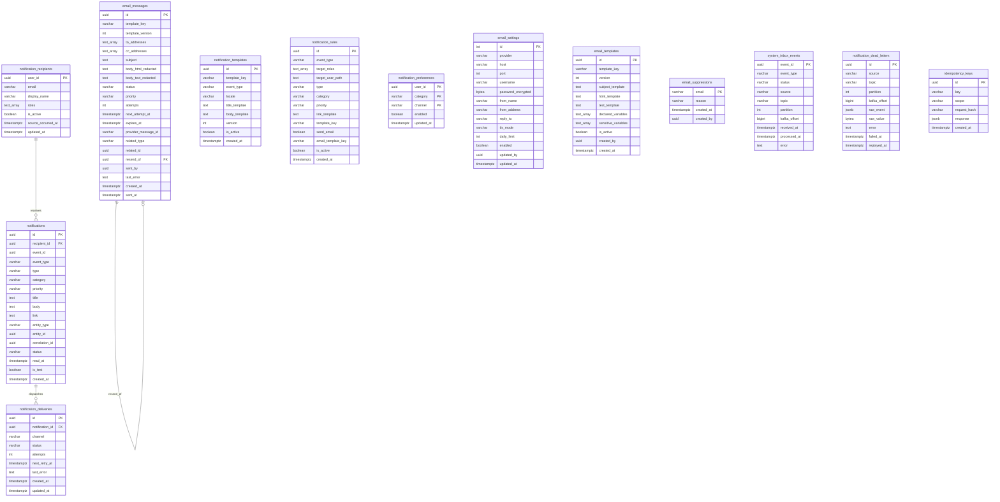

# Notification Service Database Schema Specification

This document details the PostgreSQL architecture, Mermaid Entity-Relationship (ER) diagram, table dictionaries, indexing strategies, and security invariants for `notification_db`.

---

## 1. Database Architecture & Isolation Rules

- **Dedicated Service Database**: The notification service exclusively owns `notification_db`, connected via database role `notification_user`.
- **Zero Cross-Service Foreign Keys**: External entity identifiers (e.g., `user_id` from Auth Service, `order_id` from Purchasing/Sales Services) are stored as plain `UUID` columns without cross-database foreign key constraints.
- **Internal Relational Integrity**: Foreign keys exist strictly between tables residing inside `notification_db` (`notification_deliveries` &rarr; `notifications`, and `notifications` &rarr; `notification_recipients`).
- **Strong Local Consistency**: All operations within a message boundary (inbox recording, in-app notification insertion, delivery creation, recipient updates) are committed within a single local ACID transaction.

---

## 2. Mermaid Entity-Relationship Diagram

---

## 3. Data Dictionary

### 1. `notification_recipients`
Maintains a local projection of user identity data populated from Auth domain events (`user.created`, `user.updated`, `user.roles_changed`, `user.deactivated`).
- `user_id` (`UUID`, PK): The auth service user identifier.
- `email` (`VARCHAR(255)`, NOT NULL): Current email address for email delivery.
- `display_name` (`VARCHAR(255)`, NOT NULL): Human-readable name for notification copy interpolation.
- `roles` (`TEXT[]`, NOT NULL, DEFAULT `{}`): Assigned system roles (`admin`, `manager`, `purchasing`, `warehouse`, `sales`, `finance`).
- `is_active` (`BOOLEAN`, NOT NULL, DEFAULT TRUE): Soft-deletion flag.
- `source_occurred_at` (`TIMESTAMPTZ`, NOT NULL): Event timestamp used for out-of-order event protection.
- `updated_at` (`TIMESTAMPTZ`, NOT NULL, DEFAULT `now()`): Record modification timestamp.
- **Indexes**: `idx_notification_recipients_email`, `idx_notification_recipients_is_active`.

### 2. `notification_templates`
Catalog of copy templates for in-app notifications.
- `id` (`UUID`, PK): Unique template version record ID.
- `template_key` (`VARCHAR(100)`, NOT NULL): Semantic identifier (e.g. `approval.requested`).
- `event_type` (`VARCHAR(100)`, NOT NULL): Associated domain event type.
- `locale` (`VARCHAR(10)`, NOT NULL, DEFAULT `'en'`): IETF language tag.
- `title_template` (`TEXT`, NOT NULL): Mustache/Go-template copy for notification title.
- `body_template` (`TEXT`, NOT NULL): Copy template for notification body.
- `version` (`INT`, NOT NULL, DEFAULT 1): Incremented template version number.
- `is_active` (`BOOLEAN`, NOT NULL, DEFAULT TRUE): Active template version flag.
- `created_at` (`TIMESTAMPTZ`, NOT NULL, DEFAULT `now()`): Creation timestamp.
- **Constraints**: `UNIQUE (template_key, locale, version)`.

### 3. `notification_rules`
Routing matrix mapping incoming domain events to target roles, categories, and channels.
- `id` (`UUID`, PK): Unique rule identifier.
- `event_type` (`VARCHAR(100)`, NOT NULL): Event descriptor (e.g., `purchase_order.created`).
- `target_roles` (`TEXT[]`, NOT NULL, DEFAULT `{}`): Target recipient roles (e.g., `{"purchasing", "manager"}`).
- `target_user_path` (`TEXT`, NULL): JSONPath or attribute to target a specific user (e.g. `payload.approver_id`).
- `type` (`VARCHAR(50)`, NOT NULL): Notification type classification.
- `category` (`VARCHAR(50)`, NOT NULL): Notification category (`approval`, `purchasing`, `inventory`, etc.).
- `priority` (`VARCHAR(20)`, NOT NULL, DEFAULT `'normal'`): `low`, `normal`, `high`, `critical`.
- `link_template` (`TEXT`, NULL): Relative deep link template (e.g. `/purchasing/orders/{{.id}}`).
- `template_key` (`VARCHAR(100)`, NOT NULL): In-app notification template key to render.
- `send_email` (`BOOLEAN`, NOT NULL, DEFAULT FALSE): If true, triggers outbound email creation.
- `email_template_key` (`VARCHAR(100)`, NULL): Outbound email template to use if `send_email` is true.
- `is_active` (`BOOLEAN`, NOT NULL, DEFAULT TRUE): Rule activation toggle.
- `created_at` (`TIMESTAMPTZ`, NOT NULL, DEFAULT `now()`): Creation timestamp.
- **Indexes**: `idx_notification_rules_event_active` on `(event_type, is_active)`.

### 4. `notifications`
In-app notification records presented to end users.
- `id` (`UUID`, PK): Notification primary key.
- `recipient_id` (`UUID`, FK &rarr; `notification_recipients.user_id` ON DELETE CASCADE): User receiving the notification.
- `event_id` (`UUID`, NOT NULL): Originating domain event UUID.
- `event_type` (`VARCHAR(100)`, NOT NULL): Emitting event type.
- `type` (`VARCHAR(50)`, NOT NULL): Contract notification type.
- `category` (`VARCHAR(50)`, NOT NULL): Notification category.
- `priority` (`VARCHAR(20)`, NOT NULL, DEFAULT `'normal'`): `low`, `normal`, `high`, `critical`.
- `title` (`TEXT`, NOT NULL): Rendered title string.
- `body` (`TEXT`, NOT NULL): Rendered body copy.
- `link` (`TEXT`, NULL): Navigational deep-link URL.
- `entity_type` (`VARCHAR(100)`, NULL): Aggregate domain entity type.
- `entity_id` (`UUID`, NULL): Aggregate entity UUID.
- `correlation_id` (`UUID`, NULL): Causal tracing correlation UUID.
- `status` (`VARCHAR(20)`, NOT NULL, DEFAULT `'unread'`): `unread`, `read`, `archived`.
- `read_at` (`TIMESTAMPTZ`, NULL): Timestamp when user marked item as read.
- `is_test` (`BOOLEAN`, NOT NULL, DEFAULT FALSE): Test delivery flag from admin console.
- `created_at` (`TIMESTAMPTZ`, NOT NULL, DEFAULT `now()`): Creation timestamp.
- **Constraints**: `UNIQUE (recipient_id, event_id)`.
- **Indexes**:
  - `idx_notifications_recipient_status_created` on `(recipient_id, status, created_at DESC)`
  - `idx_notifications_recipient_category_created` on `(recipient_id, category, created_at DESC)`
  - `idx_notifications_event_id` on `(event_id)`

### 5. `notification_deliveries`
Delivery tracking and status history per notification and channel.
- `id` (`UUID`, PK): Unique delivery log ID.
- `notification_id` (`UUID`, FK &rarr; `notifications.id` ON DELETE CASCADE): Notification being delivered.
- `channel` (`VARCHAR(20)`, NOT NULL): Delivery medium (`in_app`, `email`).
- `status` (`VARCHAR(20)`, NOT NULL, DEFAULT `'pending'`): `pending`, `sent`, `failed`, `dead`.
- `attempts` (`INT`, NOT NULL, DEFAULT 0): Dispatch attempt count.
- `next_retry_at` (`TIMESTAMPTZ`, NULL): Next scheduled retry attempt.
- `last_error` (`TEXT`, NULL): Failure description / error string.
- `created_at` (`TIMESTAMPTZ`, NOT NULL, DEFAULT `now()`): Initial dispatch timestamp.
- `updated_at` (`TIMESTAMPTZ`, NOT NULL, DEFAULT `now()`): Last status update timestamp.
- **Indexes**: `idx_notification_deliveries_status_retry` on `(status, next_retry_at)`.

### 6. `notification_preferences`
User notification channel toggles per category.
- `user_id` (`UUID`, PK): User owning the preference.
- `category` (`VARCHAR(50)`, PK): Domain category (`approval`, `security`, etc.).
- `channel` (`VARCHAR(20)`, PK): `in_app` or `email`.
- `enabled` (`BOOLEAN`, NOT NULL, DEFAULT TRUE): Notification toggle.
- `updated_at` (`TIMESTAMPTZ`, NOT NULL, DEFAULT `now()`): Preference modification timestamp.
- **Primary Key**: `(user_id, category, channel)`.

### 7. `email_settings`
Singleton configuration record managing SMTP credentials and provider details.
- `id` (`INT`, PK, DEFAULT 1, CHECK `id = 1`): Singleton constraint ensuring only 1 record exists.
- `provider` (`VARCHAR(50)`, NOT NULL, DEFAULT `'smtp'`): Mail driver (`smtp`, `ses`, `sendgrid`).
- `host` (`VARCHAR(255)`, NOT NULL, DEFAULT `'localhost'`): SMTP host.
- `port` (`INT`, NOT NULL, DEFAULT 1025): SMTP port (e.g. 587, 465, 1025).
- `username` (`VARCHAR(255)`, NOT NULL, DEFAULT `''`): SMTP authentication username.
- `password_encrypted` (`BYTEA`, NOT NULL): AES-GCM encrypted SMTP password using `EMAIL_ENCRYPTION_KEY`.
- `from_name` (`VARCHAR(255)`, NOT NULL): Default friendly sender name.
- `from_address` (`VARCHAR(255)`, NOT NULL): Default sender email address.
- `reply_to` (`VARCHAR(255)`, NULL): Optional reply-to address.
- `tls_mode` (`VARCHAR(20)`, NOT NULL, DEFAULT `'starttls'`): `none`, `starttls`, `ssl_tls`.
- `daily_limit` (`INT`, NOT NULL, DEFAULT 10000): Daily quota limit.
- `enabled` (`BOOLEAN`, NOT NULL, DEFAULT TRUE): Master email kill switch.
- `updated_by` (`UUID`, NULL): Admin user who modified configuration.
- `updated_at` (`TIMESTAMPTZ`, NOT NULL, DEFAULT `now()`): Modification timestamp.

### 8. `email_templates`
Versioned email templates for transactional and business messages.
- `id` (`UUID`, PK): Template version UUID.
- `template_key` (`VARCHAR(100)`, NOT NULL): Identifier (e.g. `auth.verify_email_otp`).
- `version` (`INT`, NOT NULL, DEFAULT 1): Monotonically increasing version.
- `subject_template` (`TEXT`, NOT NULL): Subject line template.
- `html_template` (`TEXT`, NOT NULL): HTML content template.
- `text_template` (`TEXT`, NOT NULL): Plain text fallback template.
- `declared_variables` (`TEXT[]`, NOT NULL, DEFAULT `{}`): Expected parameters.
- `sensitive_variables` (`TEXT[]`, NOT NULL, DEFAULT `{}`): Variables to redact from persistent message tables.
- `is_active` (`BOOLEAN`, NOT NULL, DEFAULT FALSE): Active status flag.
- `created_by` (`UUID`, NULL): Creator user UUID.
- `created_at` (`TIMESTAMPTZ`, NOT NULL, DEFAULT `now()`): Creation timestamp.
- **Constraints & Indexes**:
  - `UNIQUE (template_key, version)`
  - Partial unique index: `uq_email_templates_active_key` on `(template_key) WHERE is_active = TRUE`.

### 9. `email_messages`
Outbound email queue, audit log, and retry state machine.
- `id` (`UUID`, PK): Message record identifier.
- `template_key` (`VARCHAR(100)`, NOT NULL): Rendered template key.
- `template_version` (`INT`, NOT NULL, DEFAULT 1): Template version used.
- `to_addresses` (`TEXT[]`, NOT NULL): Primary recipient email list.
- `cc_addresses` (`TEXT[]`, NOT NULL, DEFAULT `{}`): CC recipient list.
- `subject` (`TEXT`, NOT NULL): Final rendered subject line.
- `body_html_redacted` (`TEXT`, NOT NULL): Rendered HTML with sensitive values replaced by `******`.
- `body_text_redacted` (`TEXT`, NOT NULL): Rendered plain text with sensitive values replaced by `******`.
- `status` (`VARCHAR(20)`, NOT NULL, DEFAULT `'queued'`): `queued`, `sending`, `sent`, `delivered`, `failed`, `bounced`, `suppressed`, `cancelled`.
- `priority` (`VARCHAR(20)`, NOT NULL, DEFAULT `'business'`): `transactional`, `business`.
- `attempts` (`INT`, NOT NULL, DEFAULT 0): Dispatch attempt count.
- `next_attempt_at` (`TIMESTAMPTZ`, NULL): Scheduled time for next retry attempt.
- `expires_at` (`TIMESTAMPTZ`, NULL): Expiration deadline for OTP / time-sensitive messages.
- `provider_message_id` (`VARCHAR(255)`, NULL): Message ID returned by provider or SMTP relay.
- `related_type` (`VARCHAR(100)`, NULL): Related aggregate entity type.
- `related_id` (`UUID`, NULL): Related aggregate entity UUID.
- `resend_of` (`UUID`, NULL, FK &rarr; `email_messages.id` ON DELETE SET NULL): Parent message reference if re-sent.
- `sent_by` (`UUID`, NULL): Actor user who triggered email.
- `last_error` (`TEXT`, NULL): Detailed error message from last delivery attempt.
- `created_at` (`TIMESTAMPTZ`, NOT NULL, DEFAULT `now()`): Queued timestamp.
- `sent_at` (`TIMESTAMPTZ`, NULL): Acceptance timestamp by SMTP/provider.
- **Indexes**:
  - `idx_email_messages_status_next_attempt` on `(status, next_attempt_at)`
  - `idx_email_messages_related` on `(related_type, related_id)`
  - `idx_email_messages_created_at` on `(created_at DESC)`

### 10. Security Note: `email_payload_secrets` Omission
A separate `email_payload_secrets` table is intentionally **NOT** created. In compliance with security rules:
- Secrets, OTPs, and passwords are never persisted to disk in clear text or audit tables.
- Rendered subject and body contents stored in `email_messages` have all variables listed in `sensitive_variables` redacted with `******`.
- Actual plaintext secret values exist strictly in temporary application memory during the worker's delivery execution cycle and are discarded immediately afterward.

### 11. `email_suppressions`
Suppression list tracking hard bounces and spam complaints.
- `email` (`VARCHAR(255)`, PK): Suppressed recipient email address.
- `reason` (`VARCHAR(20)`, NOT NULL): `hard_bounce`, `complaint`, `manual`.
- `created_at` (`TIMESTAMPTZ`, NOT NULL, DEFAULT `now()`): Date added to suppression list.
- `created_by` (`UUID`, NULL): Administrator UUID if manually suppressed.

### 12. `system_inbox_events`
Transactional Inbox pattern table providing idempotency and deduplication for domain events.
- `event_id` (`UUID`, PK): Event UUID.
- `event_type` (`VARCHAR(100)`, NOT NULL): Event descriptor.
- `status` (`VARCHAR(20)`, NOT NULL, DEFAULT `'received'`): `received`, `processed`, `ignored`, `failed`.
- `source` (`VARCHAR(20)`, NOT NULL): `kafka` or `http`.
- `topic` (`VARCHAR(255)`, NULL): Source Kafka topic.
- `partition` (`INT`, NULL): Source Kafka partition.
- `kafka_offset` (`BIGINT`, NULL): Source Kafka offset.
- `received_at` (`TIMESTAMPTZ`, NOT NULL, DEFAULT `now()`): Ingestion timestamp.
- `processed_at` (`TIMESTAMPTZ`, NULL): Successful processing timestamp.
- `error` (`TEXT`, NULL): Processing failure details if failed.
- **Indexes**: `idx_system_inbox_events_status_received` on `(status, received_at DESC)`, `idx_system_inbox_events_type` on `(event_type)`.

### 13. `notification_dead_letters`
Poison-pill event store for malformed or permanently unroutable messages.
- `id` (`UUID`, PK): Dead letter entry UUID.
- `source` (`VARCHAR(20)`, NOT NULL): `kafka` or `http`.
- `topic` (`VARCHAR(255)`, NULL): Source Kafka topic.
- `partition` (`INT`, NULL): Source Kafka partition.
- `kafka_offset` (`BIGINT`, NULL): Source Kafka offset.
- `raw_event` (`JSONB`, NULL): Parsed event envelope (if valid JSON).
- `raw_value` (`BYTEA`, NULL): Original raw message bytes (used when message payload is invalid JSON).
- `error` (`TEXT`, NOT NULL): Root cause explanation.
- `failed_at` (`TIMESTAMPTZ`, NOT NULL, DEFAULT `now()`): Failure timestamp.
- `replayed_at` (`TIMESTAMPTZ`, NULL): Timestamp when replayed by an administrator.
- **Indexes**: `idx_notification_dead_letters_failed_at` on `(failed_at DESC)`, `idx_notification_dead_letters_replayed` on `(replayed_at)`.

### 14. `idempotency_keys`
API operation deduplication for non-idempotent endpoints (`POST /internal/email/send`).
- `id` (`UUID`, PK): Record UUID.
- `key` (`VARCHAR(255)`, NOT NULL): Client-provided `Idempotency-Key` header.
- `scope` (`VARCHAR(100)`, NOT NULL, DEFAULT `'email_send'`): Endpoint scope.
- `request_hash` (`VARCHAR(64)`, NOT NULL): SHA-256 hash of the request body to detect payload mismatches.
- `response` (`JSONB`, NULL): Cached response payload returned on subsequent duplicate calls.
- `created_at` (`TIMESTAMPTZ`, NOT NULL, DEFAULT `now()`): Key registration timestamp.
- **Constraints**: `UNIQUE (key, scope)`.
- **Indexes**: `idx_idempotency_keys_created_at` on `(created_at)`.

### 15. Placeholder for `operations` Table
> [!NOTE]
> The `operations` table is deferred pending formal approval in Prompt 11. The current architecture delegates operational progress tracking to the Saga Orchestrator/Core Gateway, while the Notification Service emits real-time SSE updates (`event: operation`) directly to clients.
