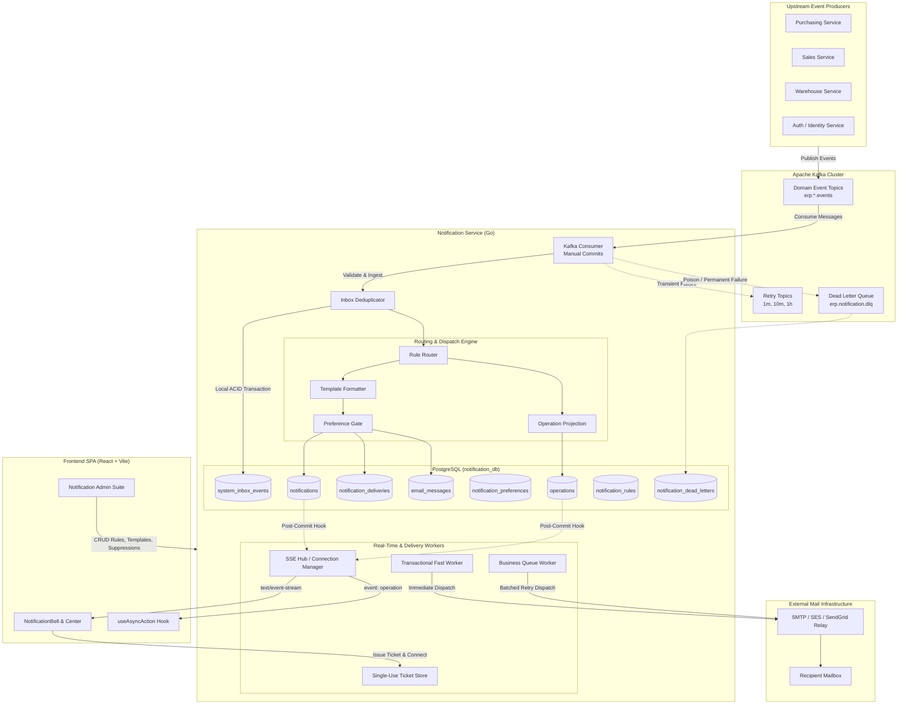
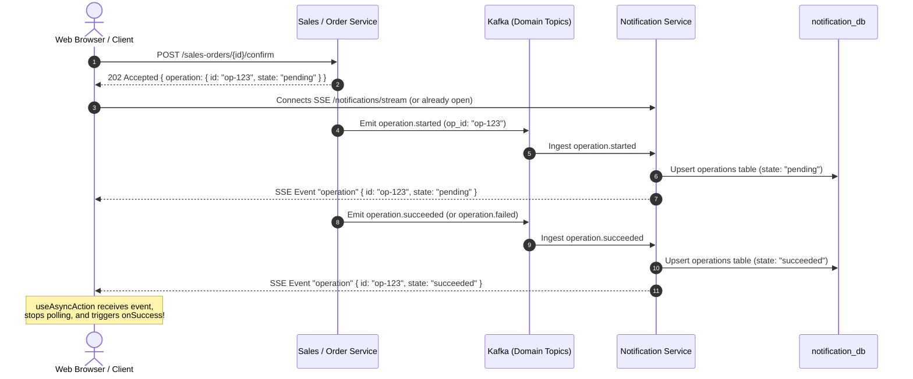

# Notification Service: Architecture, API, and Operational Guide

## 1. Executive Summary & Purpose

The **Notification Service** is a mission-critical, domain-aligned microservice designed for the Fashion ERP platform. It is responsible for orchestrating, formatting, persisting, and delivering real-time user-facing notifications, transactional security emails, and distributed asynchronous operation tracking across the enterprise.

### Core Responsibilities
1. **Choreography Event Consumer**: Ingests domain events asynchronously from Apache Kafka emitted by upstream services (e.g., Purchasing, Warehouse, Sales, Identity, Sagas) without coupling to upstream execution.
2. **Atomic Inbox Pattern**: Guarantees strict local deduplication and exactly-once business side effects inside atomic PostgreSQL ACID transactions.
3. **Multi-Channel Delivery Engine**: Routes notifications to user inboxes (in-app notifications) and email relays based on dynamic routing rules, priority, and user channel preferences.
4. **Real-Time Push Streaming**: Dispatches live notifications, unread count badges, and saga operation state changes to connected browsers over Server-Sent Events (SSE) authenticated via single-use tickets.
5. **Secure Outbound Email Infrastructure**: Manages SMTP/relay dispatch, AES-256-GCM encrypted credentials, automated retries, bounce/complaint suppression lists, daily dispatch ceilings, and sensitive variable masking (`[REDACTED]`).
6. **Async Action Projection & Polling Support**: Tracks long-running, 202-accepted asynchronous distributed operations (e.g. Sales Order confirmation, Goods Receipt posting) so frontend clients can observe real-time resolution with automatic polling fallback.

---

## 2. High-Level System Architecture



---

## 3. Data Consistency & Ingestion Engine

### 3.1 Canonical Event Envelope
Every message ingested across Kafka or the development `/internal/events` route adheres to the standard enterprise envelope:

```json
{
  "event_id": "7b8e1460-63bf-4787-8e68-07df95a5f782",
  "event_type": "sales_order.confirmed",
  "event_version": "1.0",
  "occurred_at": "2026-10-26T10:00:00Z",
  "producer": "sales-service",
  "aggregate_type": "sales_order",
  "aggregate_id": "9d1c08be-2415-46aa-bd08-8e6ca6f0e495",
  "correlation_id": "8fa8db3b-8c65-4f7b-9e45-d8aa497f1981",
  "actor_user_id": "e81d8590-bfae-4d8b-9d41-e125032b4943",
  "payload": {
    "order_number": "SO-2026-0891",
    "total": "4520.00"
  }
}
```

### 3.2 Atomic Inbox Pattern
To guarantee **exactly-once processing semantics** under at-least-once Kafka delivery:
1. `system_inbox_events` records `event_id` upon arrival.
2. If the `event_id` is already present, the consumer acknowledges duplicate delivery immediately without re-executing routing, notification generation, or email queueing.
3. The event side effects (notification rows, delivery tracking rows, operation projection updates) and the inbox record status transition to `processed` are committed in the **exact same database transaction** via `repository.TxRunner`.
4. Kafka offsets are committed **manually only after** the database transaction has successfully committed.

### 3.3 Fault Isolation & Dead-Letter Pipeline
- **Producer Protection**: Failures in the notification service never propagate to or block upstream services.
- **Malformed & Poison Bytes**: Non-JSON payloads, invalid UUIDs, and unknown envelope schemas are captured immediately, persisted into `notification_dead_letters`, published to `erp.notification.dlq`, and acknowledged to advance the Kafka partition offset.
- **Transient Failures**: Database connection timeouts or lock contentions route messages to delayed retry topics (`1m`, `10m`, `1h`) using partition fetch pauses.

### 3.4 Identity Projections & Actor Filtering
- **Identity Projections**: Listens to `user.created`, `user.updated`, and `user.roles_changed` to maintain a local read projection in `notification_recipients`.
- **Actor Exclusion**: When an event is triggered by a logged-in user, the system suppresses sending them self-notifications, unless the category is `security` (which notifies the actor of security-critical actions regardless).

---

## 4. Operation Projections & Asynchronous Actions

Distributed operations (such as Saga orchestrations, sales order releases, inventory allocations) return `202 Accepted` from upstream services with `{ data: { id, operation: { id, state } } }`.

The Notification Service maintains a consolidated projection of these actions:



### Fallback Polling Guarantee
If network disruption interrupts SSE delivery, the frontend hook [`useAsyncAction`](file:///c:/Users/sawad/erp_project_frontent/src/features/notifications/hooks/useAsyncAction.ts) automatically falls back to polling `GET /operations/{id}` every 3 seconds for up to 60 seconds.

---

## 5. Outbound Email Subsystem

### 5.1 Architecture & Dispatch Workers
Outbound email messages are categorized by priority and handled through specialized worker queues:
- **Transactional Worker (Fast Lane)**: Dispatches high-priority transactional emails (e.g. OTP verification, password resets, security alerts) immediately in-memory without queue delays. Maximum 3 delivery attempts; expires strictly at `expires_at`.
- **Business Queue Worker (Background Lane)**: Processes routine business and notification emails asynchronously with exponential backoff schedules (1 min, 5 min, 15 min, 1 hour, 6 hours).

### 5.2 Security & Sensitive Variable Redaction
> [!IMPORTANT]
> One-time passwords (OTP), authentication tokens, and credentials must **never** be stored in plaintext in the database or logged in application access logs.

- Any variable designated in `sensitive_variables` (e.g. `otp_code`) is masked with `[REDACTED]` prior to writing to `email_messages.body_html_redacted` and `body_text_redacted`.
- The email engine strictly refuses to resend any message containing sensitive variables or OTP templates (`POST /email/messages/{id}/resend` returns `409 invalid_state_transition`).
- SMTP passwords are encrypted using AES-256-GCM and are write-only through the API (`GET /admin/email-settings` returns `password_set: true|false`).

### 5.3 Reputation Management & Suppressions
- Checks all recipient addresses against `email_suppressions`.
- Automatically records hard bounces and spam complaints reported via provider webhooks (`POST /webhooks/email/{provider}`).
- Enforces an administrator-configured daily dispatch limit to prevent runaway mail loops.

---

## 6. Frontend Architecture & Integration

The frontend integration lives in two domain modules:
1. `src/features/notifications/`: User-facing notification bell, full inbox center, preferences modal, and stream listener.
2. `src/features/notifications-admin/`: Administrative control center for email configuration, templates, audit logs, rules, and delivery health.

### 6.1 Core Modules & Hooks
| Module / Hook | File | Responsibility |
|---|---|---|
| `httpClient` | [`client.ts`](file:///c:/Users/sawad/erp_project_frontent/src/features/notifications/api/client.ts) | Attaches Bearer JWT, generates `X-Request-ID`, attaches `Idempotency-Key`, performs silent token refresh on 401, standardizes `ApiError`. |
| `useNotificationStream` | [`useNotificationStream.ts`](file:///c:/Users/sawad/erp_project_frontent/src/features/notifications/hooks/useNotificationStream.ts) | Obtains single-use ticket, opens `EventSource`, updates TanStack Query cache on `notification` and `unread_count`, forwards `operation` events to event bus. |
| `useAsyncAction` | [`useAsyncAction.ts`](file:///c:/Users/sawad/erp_project_frontent/src/features/notifications/hooks/useAsyncAction.ts) | Dispatches 202 async actions, subscribes to real-time SSE resolution with 3-second polling fallback, and reports typed errors. |
| `useNotifications` | [`useNotifications.ts`](file:///c:/Users/sawad/erp_project_frontent/src/features/notifications/hooks/useNotifications.ts) | Paginated notification retrieval with optimistic mutations for `markRead`, `markUnread`, `archive`, and `readAll`. |
| `adminApi` | [`adminApi.ts`](file:///c:/Users/sawad/erp_project_frontent/src/features/notifications-admin/api/adminApi.ts) | Fully typed API client for administrative settings, template versions, message audit logs, suppressions, rules, and stats. |

---

## 7. API Contract & Endpoint Reference

### 7.1 Public User Endpoints (`Authorization: Bearer <jwt>`)
- `GET /notifications`: Paginated in-app notification list (`page`, `page_size`, `sort`, `status`, `category`, `priority`, `type`, `from`, `to`).
- `GET /notifications/unread-count`: Total and category breakdown of unread notifications.
- `GET /notifications/{id}`: Fetch single notification details.
- `POST /notifications/{id}/read`: Mark notification as read.
- `POST /notifications/{id}/unread`: Revert notification to unread.
- `POST /notifications/{id}/archive`: Move notification to archive.
- `POST /notifications/read-all`: Mark all or category-scoped notifications read.
- `GET /me/notification-preferences`: Get user channel preferences.
- `PUT /me/notification-preferences`: Update user channel preferences (returns `422 validation_failed` if attempting to disable locked security, saga, or approval in-app notifications).
- `POST /notifications/stream-ticket`: Issue a 30-second single-use ticket for SSE connection.
- `GET /notifications/stream?ticket=...`: Persistent Server-Sent Events stream (`notification`, `unread_count`, `operation`, `: heartbeat`).
- `GET /operations/{id}`: Fetch status of an async operation (accessible by actor, admin, or manager).
- `GET /operations`: Paginated list of operations filtered by `entity_type` and `entity_id`.

### 7.2 Admin Endpoints (Requires `admin` role)
- `GET /admin/email-settings`: Retrieve provider settings with masked password status.
- `PUT /admin/email-settings`: Update SMTP/relay provider configuration.
- `POST /admin/email-settings/test`: Dispatch a live probe test email.
- `GET /email/templates`: List all email templates and active versions.
- `GET /email/templates/{key}`: Retrieve template versions and parameters.
- `PUT /email/templates/{key}`: Save a new draft version of a template.
- `POST /email/templates/{key}/preview`: Render template preview with sample variables.
- `POST /email/templates/{key}/activate`: Promote a template version to active status.
- `GET /email/messages`: Search and audit outbound email records with filters.
- `GET /email/messages/{id}`: Inspect detailed message record and redacted payload.
- `POST /email/messages/{id}/resend`: Re-queue a failed/bounced business email.
- `POST /email/messages/{id}/cancel`: Cancel a queued email message.
- `GET /email/suppressions`: List blocked email addresses.
- `POST /email/suppressions`: Manually add an email address to suppressions.
- `DELETE /email/suppressions/{email}`: Remove an email address from suppressions.
- `GET /admin/notification-rules`: List routing and fan-out rules.
- `POST /admin/notification-rules`: Create routing rule.
- `PUT /admin/notification-rules/{id}`: Update routing rule.
- `DELETE /admin/notification-rules/{id}`: Deactivate routing rule.
- `GET /admin/notification-deliveries`: Query channel delivery logs and retry statuses.
- `POST /admin/notification-deliveries/{id}/retry`: Retry a failed delivery attempt.
- `GET /admin/notification-dead-letters`: Query unroutable or poisoned dead letters.
- `POST /admin/notification-dead-letters/{id}/replay`: Replay a dead-lettered message.
- `GET /admin/notification-stats`: Aggregated 24-hour delivery counts, failure rates, and queue depth.
- `GET /admin/notification-consumer-status`: Kafka consumer group lag, partitions, and committed offsets.

### 7.3 Internal & Operational Endpoints
- `POST /internal/email/send`: Dispatches high-priority or transactional emails via `X-Internal-Token` and `Idempotency-Key`.
- `POST /internal/events`: Direct HTTP event ingestion for test and simulation environments.
- `POST /webhooks/email/{provider}`: Cryptographically verified mail provider webhook handler.
- `GET /health/live`: Liveness probe (`200 OK {"status":"alive"}`).
- `GET /health/ready`: Readiness probe verifying PostgreSQL connection and Kafka broker state.
- `GET /health/version`: Build version and Git commit metadata.
- `GET /metrics`: Prometheus performance metrics guarded by `X-Internal-Token`.

---

## 8. Operational Runbook & Developer Tooling

### 8.1 Simulating Event Scenarios
The service includes a production-grade simulation CLI in `notification-service/cmd/simulate/main.go` that can publish events to Kafka or directly to `/internal/events`:

```bash
# Run happy path sales order flow
go run cmd/simulate/main.go --scenario sales-order-happy --via http

# Test deduplication handling (sends same event_id 3 times)
go run cmd/simulate/main.go --scenario duplicate --via http

# Test poison and malformed envelope handling
go run cmd/simulate/main.go --scenario poison --via http

# High-throughput batch test (5,000 events)
go run cmd/simulate/main.go --scenario bulk --count 5000 --via kafka
```

### 8.2 Development Token Generation
To generate JWT tokens for local testing against `AUTH_MODE=jwt`:

```bash
# Generate dev token using Node.js CLI script
node scripts/dev-token.mjs --sub e81d8590-bfae-4d8b-9d41-e125032b4943 --role admin,manager

# Or test via frontend mock mode
# Set VITE_USE_MOCKS=true in .env to isolate frontend from local backend services
```

### 8.3 Verification & Automated Test Suites
```bash
# Run backend Go unit and integration tests
cd notification-service
go test -v ./internal/http/... ./internal/repository/... ./internal/email/... ./internal/notification/... ./internal/ingest/... ./internal/sse/...

# Run frontend test suite
cd ..
npx vitest run

# Run TypeScript linter
npm run lint
```
